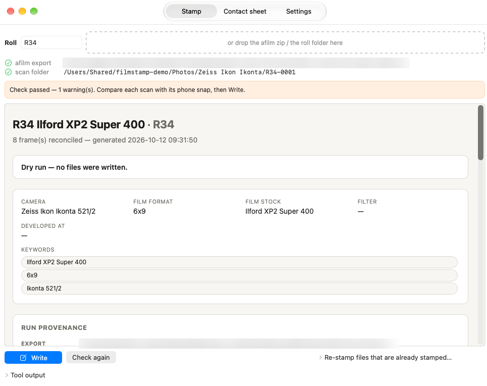
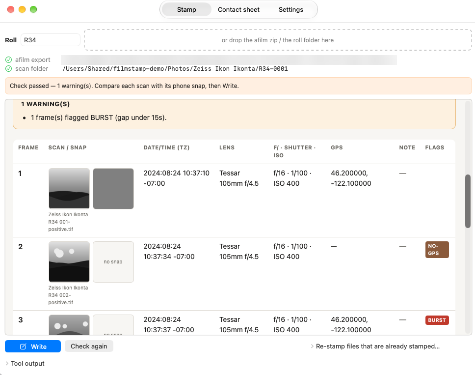
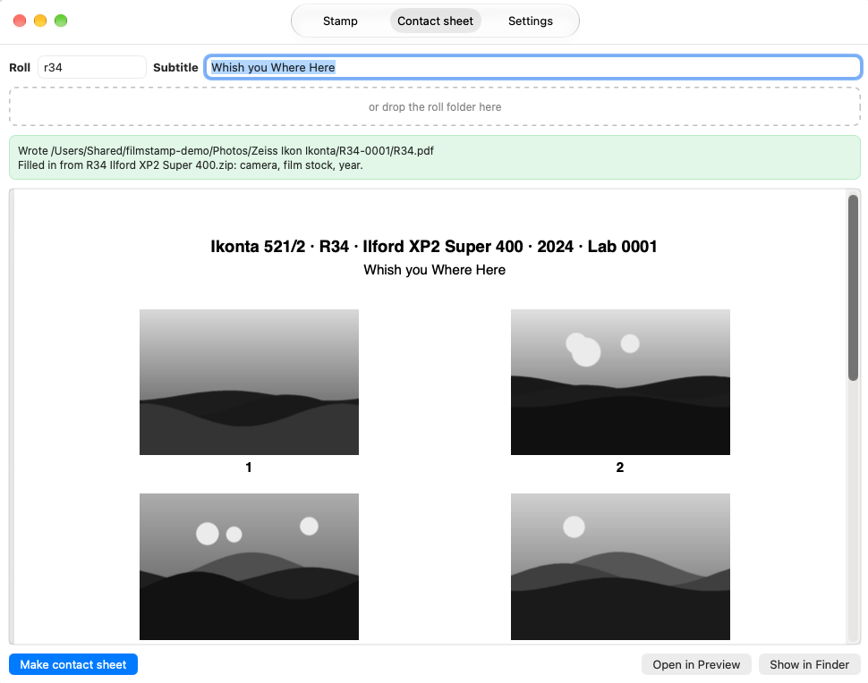

# filmstamp

Writes the per-frame data from an afilm roll export into your scanned film TIFFs, and makes a contact sheet for the binder.







## Why

afilm records aperture, shutter speed, time, GPS, lens and notes for every frame on the phone. The scans carry none of it. Lightroom only shows what is inside the files, so the data has to be matched to the scans and written into them before import. Doing that by hand is slow and easy to get wrong.

## What it does

- Reads the afilm export zip and maps frames to scan files by the `R49 001` number in the filename.
- Writes capture time, time zone, aperture, shutter, ISO, GPS, caption, lens, camera, serials, film stock and keywords as EXIF/XMP/IPTC with ExifTool.
- Derives the time zone per day from the GPS position.
- Runs a dry run first: a table plus an HTML page showing each scan next to the phone snap, so a shifted frame numbering is visible before anything is written.
- Reads every tag back after writing and fails if anything differs.
- Archives the afilm zip next to the scans.
- Makes a contact sheet PDF per roll.
- Reports which tags a roll already carries (`audit`), without writing.

## Requirements

- macOS
- Python 3.11 or later
- [ExifTool](https://exiftool.org) (`brew install exiftool`)
- Xcode Command Line Tools, only to build the app

## Install

```bash
git clone <this repo> && cd filmstamp
python3 -m venv .venv
.venv/bin/pip install -r requirements.txt
ln -s "$PWD/filmstamp" ~/bin/filmstamp
```

Then edit `roll-profile.toml`: your name, your cameras and lenses, film stocks and folders. `filmstamp check-profile roll-profile.toml` validates it.

## Use

```bash
filmstamp R49                   # dry run: table + R49.html, writes nothing to the scans
filmstamp R49 --write           # stamp, verify, archive the export
filmstamp sheet R49             # contact sheet R49.pdf
filmstamp audit R49             # what do the files already carry?
```

`R49` is looked up as the export zip in `downloads_dir` and the roll folder under `safety_root`. Full paths work too. Other options are listed by `filmstamp --help`.

Scan filenames must contain the roll and a three-digit frame, for example `R49 001` or `R49-001`.

Do not run `--write` on a roll that is already in the Lightroom catalog.

## Safety

- The tool only writes below `safety_root`, compared by resolved path.
- A write is refused while any frame has no lens, or a file is a cloud placeholder that is not downloaded.
- `R49.html` is the roll's data record. A dry run never replaces the record of a real write.
- Pause cloud sync (Synology Drive, iCloud, Dropbox) before `--write`.

## Mac app

A SwiftUI front end for the same tool: type a roll number or drop the zip. The check runs automatically, and Write only enables after a check passed for exactly those inputs.

```bash
./app/build.sh    # builds and installs /Applications/Filmstamp.app
```

The app has no stamping logic. It runs the `filmstamp` launcher in this folder.

## Tests

```bash
.venv/bin/python -m pytest -q
```

The fixtures in `tests/fixtures` are small synthetic afilm exports with placeholder images.

## Status and next step

filmstamp currently reads roll exports from **afilm**. afilm has had no update since 2023 and may become a dead end, for example when it no longer installs on a new phone.

The path to investigate next is **[Exif Notes](https://github.com/tommi1hirvonen/ExifNotes)**, an open-source and actively maintained field log. Its data model already covers what afilm lacks: lens make and model, filters, film stock with process, and fixed-lens cameras.

It does not yet fit this workflow:

- A roll export contains no reference photos. They can only be exported for all rolls at once ([requested: #79](https://github.com/tommi1hirvonen/ExifNotes/issues/79)).
- Timestamps are stored to the minute, so burst logging can't be detected.
- Deleting a roll silently removes its reference photos.
- Teleconverter and per-frame time zone support are still pending upstream ([PR #73](https://github.com/tommi1hirvonen/ExifNotes/pull/73)).

Planned approach: add a second input parser alongside the afilm one. Stamping, verification, the review page and the contact sheet stay unchanged, and rolls logged in afilm remain supported.

## License

MIT, see [LICENSE](LICENSE).
